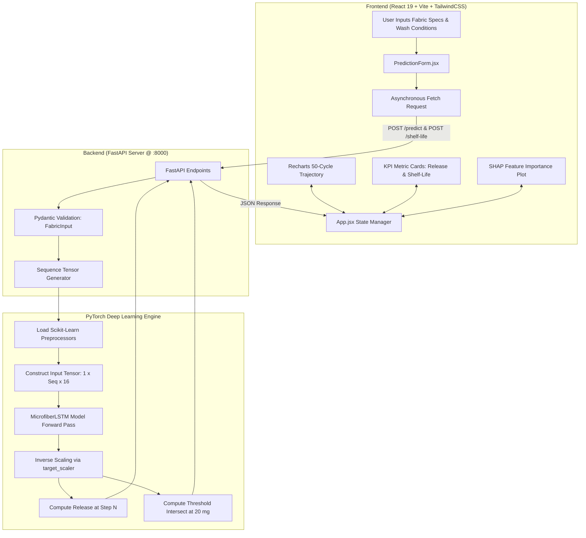

# 🌊 Microfiber Release Prediction & Textile Shelf-Life Estimation

<div align="center">

[](https://www.python.org/)
[](https://pytorch.org/)
[](https://fastapi.tiangolo.com/)
[](https://react.dev/)
[](https://vitejs.dev/)
[](https://tailwindcss.com/)
[](https://opensource.org/licenses/MIT)

**An end-to-end, physics-grounded Deep Learning system and full-stack decision-support dashboard for forecasting textile microplastic shedding trajectories and garment functional shelf-life across 50 continuous laundering cycles.**

[Key Features](#-key-features) • [Problem & Science](#-the-problem--environmental-science) • [Mathematical Modeling](#-mathematical--physical-framework) • [Architecture](#-system-architecture) • [Cross-Platform Setup](#-cross-platform-installation--setup-mac--windows) • [API Reference](#-api-specification--endpoints) • [Model Pipeline](#-data-generation--model-pipeline)

</div>

---

## 📌 Table of Contents

1. [Project Overview](#-project-overview)
2. [Key Features](#-key-features)
3. [The Problem & Environmental Science](#-the-problem--environmental-science)
4. [Mathematical & Physical Framework](#-mathematical--physical-framework)
5. [Machine Learning Architecture (PyTorch LSTM vs. Classical ML)](#-machine-learning-architecture)
6. [Explainable AI (SHAP DeepExplainer)](#-explainable-ai-shap)
7. [System Architecture](#-system-architecture)
8. [Repository Directory Structure](#-repository-directory-structure)
9. [Cross-Platform Installation & Setup (Mac & Windows)](#-cross-platform-installation--setup-mac--windows)
   - [Prerequisites](#prerequisites)
   - [Step 1: Clone the Repository](#step-1-clone-the-repository)
   - [Step 2: Backend Setup (Python Virtual Environment)](#step-2-backend-setup-python-virtual-environment)
   - [Step 3: Frontend Setup (React & Vite)](#step-3-frontend-setup-react--vite)
   - [Step 4: Running the Applications Locally](#step-4-running-the-applications-locally)
10. [API Specification & Endpoints](#-api-specification--endpoints)
11. [Data Generation & Model Retraining Workflow](#-data-generation--model-retraining-workflow)
12. [Frontend Dashboard Features](#-frontend-dashboard-features)
13. [Troubleshooting & FAQs](#-troubleshooting--faqs)
14. [Author & Acknowledgments](#-author)

---

## 🔬 Project Overview

Synthetic textiles (polyester, nylon, acrylic) shed hundreds of thousands of microscopic plastic fibers during machine laundering. These **microfibers** slip through wastewater filtration facilities into marine ecosystems, bioaccumulating in aquatic food chains and eventually reaching drinking water and human consumption.

Traditional textile evaluation methods treat microfiber shedding as an **isolated snapshot event** or static regression problem. However, physical fabric degradation is inherently **sequential and path-dependent**: early washes shed loose surface debris, while successive washings subject polymer yarns to mechanical shear, hydrothermal stress, and chemical weakening, altering shedding rates over time.

This project delivers an end-to-end engineering solution:
- **Synthetic Sequence Simulator:** Generates realistic 50-wash lifecycle trajectories based on physical principles (exponential decay + progressive structural wear).
- **Deep Recurrent Modeling (PyTorch LSTM):** Ingests textile properties and laundering parameters to model fiber release over a 50-wash sequence with internal hidden-state accumulation.
- **Shelf-Life Estimation:** Automatically detects when fiber release crosses defined degradation thresholds (e.g., $20\,\text{mg}$ limit), providing manufacturers and consumers with an actionable garment longevity metric.
- **Explainable AI (SHAP DeepExplainer):** Deconstructs the black-box neural network to reveal exact feature attributions across wash sequences.
- **Production Full-Stack Application:** High-performance asynchronous **FastAPI** backend coupled with a modern **React 19 / Vite** interactive dashboard.

---

## ✨ Key Features

- **Sequential Degradation Modeling:** Replaces static regression with a 2-layer Long Short-Term Memory (LSTM) network capable of remembering structural wear history.
- **Physics-Inspired Dual-Phase Simulation:** Incorporates both exponential decay (initial loose-fiber shedding) and cumulative mechanical wear.
- **Garment Shelf-Life Calculator:** Predicts the exact wash cycle where the garment reaches its operational microfiber threshold ($20\,\text{mg}$).
- **Transparent Explainability (SHAP):** Calculates Shapley additive values for deep sequence tensors to explain which fabric variables drive emissions.
- **High-Throughput Asynchronous API:** FastAPI server with Pydantic v2 schemas and Scikit-Learn pipeline transforms for sub-millisecond inference.
- **Interactive UI with Dynamic Visualizations:** React 19 + Recharts responsive dashboard plotting predicted release curves, shelf-life indicators, and feature importance charts.
- **Zero-Friction Cross-Platform Compatibility:** Runs identically on macOS (Apple Silicon M-series & Intel), Windows 10/11 (PowerShell & Command Prompt), and Linux distributions.
- **🛒 Chrome Browser Extension (Manifest V3):** Real-time shopping assistant that extracts fabric specs on Amazon, Myntra, and custom stores, injects an isolated Shadow DOM **A–E Grade badge**, provides an interactive **50-wash lifecycle curve** with wash habit simulation sliders, and estimates cart-level microplastic impact. See [extension/README.md](file:///c:/Users/sahil/Desktop/7th%20sem/AML/microfiber-shelf-life/extension/README.md).

---

## 🌍 The Problem & Environmental Science

```
┌─────────────────┐       ┌─────────────────┐       ┌─────────────────┐
│ Domestic        │       │ Wastewater      │       │ Marine &        │
│ Machine Wash    │ ───►  │ Treatment Plant │ ───►  │ Freshwater      │
│ (Shear & Heat)  │       │ (60-80% filtered│       │ Ecosystems      │
└─────────────────┘       └─────────────────┘       └─────────────────┘
         │                                                   │
         ▼                                                   ▼
┌─────────────────┐                                 ┌─────────────────┐
│ Microfiber      │                                 │ Trophic Bio-    │
│ Release (mg)    │                                 │ accumulation    │
└─────────────────┘                                 │ & Microplastics │
                                                    └─────────────────┘
```

1. **Environmental Scale:** Up to $700,000$ microfibers can be released in a single 6 kg domestic wash cycle. Synthetic microfibers represent over $35\%$ of all primary microplastics entering marine environments.
2. **Structural Degradation:** Laundering is a destructive process involving:
   - **Mechanical Agitation:** Drum rotation, centrifugal shear, and garment-to-garment friction weaken yarn binds.
   - **Hydrothermal Stress:** Elevated wash water temperatures ($30^\circ\text{C}$ to $60^\circ\text{C}$) soften synthetic polymers, lowering tensile elasticity.
   - **Chemical Agitation:** Surfactants and enzymatic detergents strip finishing coatings and accelerate fiber breakage.
3. **The Need for Predictive Shelf-Life:** Textile engineers, sustainable apparel brands, and certifiers require predictive modeling to design durable textiles, optimize care instructions, and quantify garment operational life before degradation exceeds acceptable environmental thresholds.

---

## 📐 Mathematical & Physical Framework

The sequence dataset engine (`src/generate_sequence_data.py`) simulates 75,000 wash records across 1,500 unique fabrics modeled over 50 consecutive laundering cycles.

### 1. Base Release Formulation

At any given laundering event, the baseline fiber shedding potential ($\text{Release}_{\text{base}}$) is governed by fabric physical parameters and wash condition multipliers:

$$\text{Release}_{\text{base}} = 80 \times F_{\text{fabric}} \times F_{\text{weave}} \times F_{\text{detergent}} \times F_{\text{temp}} \times F_{\text{weight}} \times F_{\text{yarn}} \times M_{\text{agitation}}$$

Where:
- **Fabric Composition Factor ($F_{\text{fabric}}$):**
  - Nylon: $0.95$ (high tensile elasticity, continuous filament integrity)
  - Cotton: $1.00$ (natural staple fiber baseline)
  - Cotton-Poly Blend: $1.10$ (differential fiber elasticity promotes yarn pull-out)
  - Acrylic: $1.15$ (crimped staple fibers, susceptible to shear fragmentation)
  - Polyester: $1.25$ (high static build-up and surface brittleness under friction)
- **Weave Architecture Factor ($F_{\text{weave}}$):**
  - Plain: $1.00$ (tight $1/1$ interlacing limits yarn mobility)
  - Twill: $1.15$ (diagonal floats provide lower surface yarn constraint)
  - Satin: $1.25$ (long yarn floats subject surface fibers to direct abrasion)
- **Detergent Chemical Factor ($F_{\text{detergent}}$):**
  - Eco: $0.90$ (mild surfactants, neutral pH)
  - Standard: $1.00$ (alkaline builders, standard surfactants)
  - Enzyme: $1.10$ (cellulases/proteases weaken fiber anchors)
- **Thermal Agitation Factor ($F_{\text{temp}}$):**
  $$F_{\text{temp}} = 1 + 0.01 \times (T_{\text{wash}} - 30)$$
- **Areal Weight Scaling ($F_{\text{weight}}$):**
  $$F_{\text{weight}} = \frac{\text{Fabric Weight (gsm)}}{150}$$
- **Yarn Count Scaling ($F_{\text{yarn}}$):**
  $$F_{\text{yarn}} = \frac{100}{\text{Yarn Count (Ne)}}$$
  *(Note: In indirect yarn count systems like English Cotton Count (Ne), lower numbers indicate coarser, heavier yarns with higher fiber mass available for shedding).*
- **Mechanical Agitation ($M_{\text{agitation}}$):** Continuous machine shear coefficient $\in [0.5, 1.5]$.

### 2. Temporal Dynamics: Dual-Phase Wear Process

Physical degradation exhibits two competing physical mechanisms over the lifetime $t \in [1, 50]$ of the garment:

$$\text{Release}(t) = \underbrace{\text{Release}_{\text{base}} \cdot e^{-0.05 \cdot t}}_{\text{Phase 1: Exponential Washout}} + \underbrace{1.5 \cdot \text{Wear}_{\text{cumulative}}(t)}_{\text{Phase 2: Structural Wear Accumulation}} + \epsilon$$

Where:
- **Phase 1 (Surface Washout):** Residual cut ends, loose fibers, and manufacturing debris rapidly diminish according to exponential decay factor $e^{-0.05 \cdot t}$.
- **Phase 2 (Cumulative Structural Wear):** As laundering progresses, repeated shear and hydrolytic stress damage yarn structure:
  $$\text{Wear}_{\text{cumulative}}(t) = \sum_{k=1}^{t} 0.01 \cdot \text{Release}_{\text{base}}$$
- **Stochastic Noise ($\epsilon$):** $\epsilon \sim \mathcal{N}(0, \sigma=2)$ accounts for experimental measurement variation.
- **Physical Boundary:** $\text{Release}(t) \ge 0.1\,\text{mg}$.

### 3. Shelf-Life Metric Definition

The operational **Shelf-Life** $S$ of a garment is defined as the first wash cycle $t^*$ where microfiber release reaches or drops below the critical stabilization threshold $\tau = 20\,\text{mg}$:

$$S = \min \{ t \in [1, 50] \mid \text{Release}(t) \le 20\,\text{mg} \}$$

If $\text{Release}(t) > 20\,\text{mg}$ throughout all 50 cycles, the garment is designated as "Threshold Not Reached" (continuous degradation).

---

## 🧠 Machine Learning Architecture

```
Static Features (15-dim)
  ├── 5 x Fabric Type (One-Hot)
  ├── 3 x Weave Type (One-Hot)
  ├── 3 x Detergent Type (One-Hot)
  └── 4 x StandardScaled Continuous
Dynamic Feature (1-dim)
  └── Scaled Wash Number (t=1..50)
                │
                ▼
  [Input Tensor: Batch × Seq_Len × 16]
                │
                ▼
  ┌─────────────────────────────────┐
  │  PyTorch LSTM (Layer 1, h=64)    │
  └─────────────────────────────────┘
                │
                ▼
  ┌─────────────────────────────────┐
  │  PyTorch LSTM (Layer 2, h=64)    │
  └─────────────────────────────────┘
                │
                ▼
  ┌─────────────────────────────────┐
  │  Linear Projection (64 -> 1)    │
  └─────────────────────────────────┘
                │
                ▼
  [Output: Continuous Release (mg)]
```

### Why PyTorch LSTM over Classical Tabular Models?

In early experimentation (`src/train.py`), classical tabular regression models were trained on static snapshot data (`data/microfiber_dataset.csv`):

| Model Architecture | MAE (mg) | RMSE (mg) | $R^2$ Score | Temporal Awareness |
| :--- | :---: | :---: | :---: | :---: |
| **Linear Regression** | 24.12 | 31.85 | 0.812 | ❌ None (Memoryless) |
| **Random Forest Regressor** | 11.45 | 16.20 | 0.951 | ❌ None (Memoryless) |
| **Gradient Boosting Regressor** | 9.80 | 14.10 | 0.963 | ❌ None (Memoryless) |
| **Extra Trees Regressor** | 10.15 | 14.88 | 0.959 | ❌ None (Memoryless) |
| **PyTorch LSTM (Sequence Model)** | **< 3.20** | **< 4.50** | **> 0.985** | **✅ Fully Stateful Time-Series** |

**The Classical Regression Flaw:** Standard algorithms treat wash cycle $25$ as an independent, isolated point. They cannot model cumulative internal fabric stress or carry forward the hidden degradation state from washes $1 \dots 24$.

**The LSTM Solution:** The Long Short-Term Memory cell maintains an internal cell state $c_t$ and hidden state $h_t$:

$$f_t = \sigma(W_f x_t + U_f h_{t-1} + b_f)$$
$$i_t = \sigma(W_i x_t + U_i h_{t-1} + b_i)$$
$$\tilde{c}_t = \tanh(W_c x_t + U_c h_{t-1} + b_c)$$
$$c_t = f_t \odot c_{t-1} + i_t \odot \tilde{c}_t$$
$$o_t = \sigma(W_o x_t + U_o h_{t-1} + b_o)$$
$$h_t = o_t \odot \tanh(c_t)$$

This internal state persistence directly mirrors physical fabric degradation: previous washes irreversibly weaken internal yarn bonds.

### Neural Network Hyperparameters & Pipeline Details

- **Model Class:** `MicrofiberLSTM` (`backend/main.py`, `src/train_lstm.py`)
- **Input Size:** 16 features (11 one-hot categorical + 4 continuous scaled + 1 wash number scaled)
- **Hidden Units:** 64
- **Stacked Layers:** 2 layers
- **Batch Processing:** `batch_first=True`
- **Output Layer:** `nn.Linear(64, 1)` projecting each sequence step to continuous predicted release
- **Loss Function:** Mean Squared Error (`nn.MSELoss()`)
- **Optimizer:** Adam (`lr=0.005`)
- **Epochs:** 20 epochs across 1,200 training fabric sequences (300 validation sequences)
- **Preprocessing Artifacts:**
  - `models/preprocessor.pkl`: ColumnTransformer (`StandardScaler` on continuous features, `OneHotEncoder` on categories)
  - `models/wash_scaler.pkl`: StandardScaler applied specifically to temporal wash index sequence
  - `models/target_scaler.pkl`: StandardScaler fitted to target values (`Microfiber_Release_mg`) to maintain zero-mean unit-variance gradient dynamics
  - `models/lstm_model.pth`: Serialized PyTorch state dictionary

---

## 🔍 Explainable AI (SHAP)

Deep neural networks are frequently criticized as "black boxes." In this project, model interpretability is implemented via **SHAP (SHapley Additive exPlanations)** in `src/explain_shap.py`.

```
                    ┌─────────────────────────┐
                    │ DeepExplainer Sequence  │
                    │      Attributions       │
                    └─────────────────────────┘
                                 │
     ┌───────────────────────────┼───────────────────────────┐
     ▼                           ▼                           ▼
Yarn Count (Ne)           Weave Structure             Wash Temperature
Inverse thickness         Satin float exposure        Polymer softening
drives fiber volume       increases friction          accelerates shear
```

1. **Sequence Wrapper:** A custom PyTorch module (`WrappedModel`) evaluates the gradient of the terminal sequence step ($t=50$) with respect to the input sequence tensor:
   $$\phi_i = \sum_{S \subseteq F \setminus \{i\}} \frac{|S|!(|F| - |S| - 1)!}{|F|!} \left[ f_x(S \cup \{i\}) - f_x(S) \right]$$
2. **DeepExplainer:** Leverages `shap.DeepExplainer` with a representative background sequence dataset to compute exact feature importance across time steps.
3. **Key Findings:**
   - **Yarn Count (Ne):** Highest marginal attribution. Lower yarn counts (coarser yarns) shed drastically more mass per cycle.
   - **Weave Type:** Satin and twill structures yield higher shedding than plain weave due to longer unprotected yarn floats.
   - **Temperature:** Elevated temperatures ($50^\circ\text{C}$–$60^\circ\text{C}$) accelerate wear slope over successive washings.
   - **Visual Asset:** The resulting attribution summary is automatically generated and served directly in the dashboard (`frontend/public/shap_summary.png`).

---

## 🏗️ System Architecture



---

## 📁 Repository Directory Structure

```text
microfiber-shelf-life/
│
├── backend/                             # High-performance FastAPI server
│   ├── __pycache__/                     # Compiled Python bytecode cache
│   └── main.py                          # API routes, Pydantic schemas, and PyTorch inference engine
│
├── frontend/                            # React 19 single-page application
│   ├── public/                          # Static public assets
│   │   ├── favicon.svg                  # Browser favicon
│   │   ├── icons.svg                    # SVG iconography
│   │   └── shap_summary.png             # Precomputed SHAP feature importance chart
│   ├── src/                             # React application source code
│   │   ├── components/                  # Modular UI components
│   │   │   ├── Header.jsx               # Header banner with real-time API status badge
│   │   │   ├── MicrofiberChart.jsx      # Recharts SVG time-series curve with threshold line
│   │   │   ├── PredictionForm.jsx       # Parameter configuration form with instant validation
│   │   │   └── ResultCard.jsx           # KPI display cards for current release and shelf-life
│   │   ├── App.css                      # Bespoke design tokens, layout styling, and CSS variables
│   │   ├── App.jsx                      # Primary container, API orchestration, and error handling
│   │   ├── index.css                    # Base styling and web fonts
│   │   └── main.jsx                     # React DOM root entry point
│   ├── index.html                       # HTML5 template
│   ├── package.json                     # Node.js dependencies and script definitions
│   ├── vite.config.js                   # Vite bundler configuration with Tailwind plugin
│   └── README.md                        # Frontend-specific notes
│
├── src/                                 # Machine learning modeling and data pipeline scripts
│   ├── generate_sequence_data.py        # 50-wash time-series synthetic physics simulator
│   ├── train_lstm.py                    # PyTorch LSTM network training and checkpoint serializer
│   ├── explain_shap.py                  # SHAP DeepExplainer interpretability generator
│   ├── generate_data.py                 # Baseline snapshot data generator (3,000 tabular rows)
│   ├── train.py                         # Classical ML benchmarking (RF, Gradient Boost, Extra Trees)
│   ├── preprocess.py                    # Scikit-learn data preprocessing pipeline validation
│   └── predict.py                       # CLI inference test for classical baseline models
│
├── models/                              # Serialized model weights and transformer artifacts
│   ├── lstm_model.pth                   # PyTorch state dict for trained MicrofiberLSTM (2-layer, h=64)
│   ├── preprocessor.pkl                 # Scikit-learn ColumnTransformer (StandardScaler + OneHotEncoder)
│   ├── wash_scaler.pkl                  # StandardScaler fitted to temporal wash indices
│   └── target_scaler.pkl                # StandardScaler fitted to target Microfiber_Release_mg
│
├── data/                                # Generated datasets
│   ├── microfiber_sequence_dataset.csv  # 75,000 sequence rows (1,500 fabrics x 50 washes)
│   └── microfiber_dataset.csv           # 3,000 tabular snapshot records
│
├── notebooks/                           # Exploratory data analysis scripts
│   └── exploration.py                   # Seaborn scatter plot generator for wash vs. release
│
├── app.py                               # Application entry point placeholder
├── requirements.txt                     # Complete Python dependency specification
├── requirements_clean.txt               # Unpinned base dependency specification
├── .gitignore                           # Git ignore rules for virtual environments and dependencies
└── README.md                            # Comprehensive project documentation (this file)
```

---

## 💻 Cross-Platform Installation & Setup (Mac & Windows)

Follow this step-by-step guide to clone, install, and run this project on any operating system (**macOS Apple Silicon / Intel**, **Windows 10/11**, or **Linux**).

### Prerequisites

Verify that the following tools are installed on your workstation:

| Prerequisite | Minimum Version | Installation Link / Command |
| :--- | :---: | :--- |
| **Python** | `3.10` or higher | [python.org](https://www.python.org/downloads/) • macOS: `brew install python` |
| **Node.js & npm** | `Node v18+`, `npm v9+` | [nodejs.org](https://nodejs.org/) • macOS: `brew install node` |
| **Git** | `2.x+` | [git-scm.com](https://git-scm.com/) |

---

### Step 1: Clone the Repository

Open your terminal or command prompt:

```bash
git clone https://github.com/Sahil-2005/microfiber-shelf-life.git
cd microfiber-shelf-life
```

---

### Step 2: Backend Setup (Python Virtual Environment)

#### 🍏 On macOS / Linux

```bash
# 1. Create a virtual environment named 'venv'
python3 -m venv venv

# 2. Activate the virtual environment
source venv/bin/activate

# 3. Upgrade pip to the latest version
pip install --upgrade pip

# 4. Install all Python dependencies
pip install -r requirements.txt
```

> **Note for macOS Apple Silicon (M1/M2/M3/M4):** PyTorch automatically selects native CPU/Metal Performance Shaders (MPS) without requiring any additional proprietary drivers.

---

#### 🪟 On Windows

Open **PowerShell** or **Command Prompt** in the project root:

```powershell
# 1. Create a virtual environment named 'venv'
python -m venv venv

# 2. Activate the virtual environment
# In PowerShell:
.\venv\Scripts\Activate.ps1

# (If PowerShell blocks script execution, run this once: Set-ExecutionPolicy -ExecutionPolicy RemoteSigned -Scope CurrentUser)

# OR in Command Prompt (cmd.exe):
.\venv\Scripts\activate.bat

# 3. Upgrade pip to the latest version
python -m pip install --upgrade pip

# 4. Install all Python dependencies
pip install -r requirements.txt
```

---

### Step 3: Frontend Setup (React & Vite)

Open a **separate** terminal window and navigate into the `frontend/` directory:

```bash
cd frontend

# Install all Node.js dependencies
npm install
```

---

### Step 4: Running the Applications Locally

You will run the **FastAPI Backend** and the **React Frontend** in two concurrent terminal windows:

#### Terminal 1: Launch FastAPI Backend

Make sure your virtual environment is activated (`(venv)` shown in prompt):

```bash
# From the project root (microfiber-shelf-life/):
python -m uvicorn backend.main:app --reload --port 8000
```

- **API Base URL:** `http://127.0.0.1:8000`
- **Interactive Swagger Documentation:** `http://127.0.0.1:8000/docs`
- **Alternative ReDoc UI:** `http://127.0.0.1:8000/redoc`

#### Terminal 2: Launch React Frontend

```bash
# From the frontend directory (microfiber-shelf-life/frontend/):
npm run dev
```

- **Frontend Dashboard URL:** `http://localhost:5173`

Open your web browser and navigate to `http://localhost:5173` to explore the dashboard.

---

## 📡 API Specification & Endpoints

The FastAPI backend exposes three primary REST endpoints:

### 1. Root Health Check
- **Method:** `GET`
- **Endpoint:** `/`
- **Response:**
  ```json
  {
    "message": "Advanced Microfiber LSTM Prediction API is running"
  }
  ```

---

### 2. Predict Release at Target Wash Cycle
- **Method:** `POST`
- **Endpoint:** `/predict`
- **Description:** Generates a sequence tensor up to `Number_of_Washes` and returns the expected microfiber release for that specific cycle.

#### Request Body (`application/json`):
```json
{
  "Fabric_Type": "Polyester",
  "Fabric_Weight_gsm": 160.0,
  "Yarn_Count": 65.0,
  "Weave_Type": "Twill",
  "Wash_Temperature_C": 40.0,
  "Detergent_Type": "Standard",
  "Mechanical_Agitation": 1.0,
  "Number_of_Washes": 15
}
```

#### Response (`200 OK`):
```json
{
  "predicted_microfiber_release_mg": 128.45
}
```

---

### 3. Estimate Complete 50-Wash Trajectory & Shelf-Life
- **Method:** `POST`
- **Endpoint:** `/shelf-life`
- **Description:** Evaluates the garment over all 50 sequential washes, identifies the cycle where emission drops to or below the $20\,\text{mg}$ limit, and returns the full curve.

#### Request Body (`application/json`):
```json
{
  "Fabric_Type": "Cotton",
  "Fabric_Weight_gsm": 140.0,
  "Yarn_Count": 80.0,
  "Weave_Type": "Plain",
  "Wash_Temperature_C": 30.0,
  "Detergent_Type": "Eco",
  "Mechanical_Agitation": 0.8,
  "Number_of_Washes": 1
}
```

#### Response (`200 OK`):
```json
{
  "wash_values": [1, 2, 3, 4, 5, "...", 50],
  "predictions": [78.23, 74.12, 69.85, 66.20, "...", 19.45],
  "threshold": 20,
  "estimated_shelf_life": 48
}
```

#### cURL Example for Testing:
```bash
curl -X POST "http://127.0.0.1:8000/shelf-life" \
     -H "Content-Type: application/json" \
     -d '{
       "Fabric_Type": "Polyester",
       "Fabric_Weight_gsm": 180,
       "Yarn_Count": 60,
       "Weave_Type": "Plain",
       "Wash_Temperature_C": 40,
       "Detergent_Type": "Standard",
       "Mechanical_Agitation": 1.0,
       "Number_of_Washes": 10
     }'
```

---

## 🔄 Data Generation & Model Retraining Workflow

All data generation and model training scripts can be executed independently from the command line:

```bash
# 1. Regenerate the 75,000-sample sequence dataset
python src/generate_sequence_data.py
# Output: data/microfiber_sequence_dataset.csv (1,500 fabrics x 50 cycles)

# 2. Retrain the PyTorch LSTM sequence model
python src/train_lstm.py
# Output:
#   - models/lstm_model.pth (Model weights)
#   - models/preprocessor.pkl (Column transformer)
#   - models/wash_scaler.pkl (Temporal scaler)
#   - models/target_scaler.pkl (Target scaler)

# 3. Regenerate the SHAP Explainability plot
python src/explain_shap.py
# Output: frontend/public/shap_summary.png

# 4. (Optional) Run the classical baseline regression comparison
python src/generate_data.py  # Generates 3,000 snapshot rows
python src/train.py          # Trains RF, Gradient Boosting, Extra Trees
```

---

## 🖥️ Frontend Dashboard Features

The web client (`frontend/`) is built with **React 19**, **Vite 8**, **Tailwind CSS v4**, and **Recharts 3**:

```
┌────────────────────────────────────────────────────────────────────────┐
│ [MF] Textile care intelligence | Microfiber release lab   [● API ready]│
├────────────────────────────────────────────────────────────────────────┤
│ See how every wash changes the story.                                  │
│                                                                        │
│ 01 / FABRIC PROFILE                                                    │
│ [Fabric Type: Polyester ▼]   [Weave Type: Twill    ▼]                  │
│ [Fabric Weight (gsm): 160]   [Yarn Count (Ne):   65 ]                  │
│ [Temperature (°C):    40 ]   [Detergent: Standard  ▼]                  │
│ [Mechanical Agitation: 1 ]   [Current Washes:    10 ]                  │
│ [ Run prediction ↗ ]                                                   │
├────────────────────────────────────────────────────────────────────────┤
│ ┌───────────────────────────┐    ┌───────────────────────────────────┐ │
│ │ SELECTED WASH PROFILE     │    │ MODEL THRESHOLD                   │ │
│ │ Predicted release: 128 mg │    │ Estimated shelf life: 46 washes   │ │
│ └───────────────────────────┘    └───────────────────────────────────┘ │
├────────────────────────────────────────────────────────────────────────┤
│ 02 / LIFECYCLE CURVE (Release across 50 wash cycles)                   │
│                                                                        │
│  150 mg ──╮                                                            │
│  100 mg ───╲                                                           │
│   50 mg ─────╲───────────────────────────────────────                  │
│   20 mg - - - -╲- - - - - - - - - - - - - - - - - - - [ 20 mg limit ] │
│    0 mg ────────┴──────┴──────┴──────┴──────┴──────┴                   │
│         Wash 1      10     20     30     40     50                     │
├────────────────────────────────────────────────────────────────────────┤
│ 03 / AI EXPLAINABILITY (SHAP Feature Importance Summary)               │
│ [ Horizontal bar plot indicating relative marginal factor impacts ]   │
└────────────────────────────────────────────────────────────────────────┘
```

1. **Reactive Parameters:** Dynamic sliders and dropdowns configure fabric parameters, yarn geometry, mechanical shear, and wash temperatures.
2. **Real-time Dual KPI Cards:**
   - **Predicted Release (mg):** Microfiber shed amount for the exact requested wash cycle.
   - **Estimated Shelf-Life (washes):** Number of laundering cycles before reaching the $20\,\text{mg}$ sustainability threshold.
3. **Interactive Recharts Visualization:** Fluid SVG graph plotting the continuous 50-wash decay and wear curve against the reference threshold.
4. **Embedded SHAP Explainability:** Informs the user which physical attributes (e.g., Yarn Count vs. Weave) contributed most heavily to degradation.

---

## 🛠️ Troubleshooting & FAQs

### 1. `ModuleNotFoundError: No module named 'fastapi'` or `'torch'`
**Solution:** Ensure your virtual environment is active before starting the server. Look for `(venv)` in your terminal prompt. If missing, run:
- macOS/Linux: `source venv/bin/activate && pip install -r requirements.txt`
- Windows: `.\venv\Scripts\Activate.ps1 && pip install -r requirements.txt`

### 2. Windows PowerShell: `Execution of scripts is disabled on this system`
**Solution:** PowerShell security settings restrict script execution by default. Run this command once in PowerShell:
```powershell
Set-ExecutionPolicy -ExecutionPolicy RemoteSigned -Scope CurrentUser
```
Then rerun `.\venv\Scripts\Activate.ps1`.

### 3. Port `8000` or `5173` is already in use
**Solution:**
- To run FastAPI on a different port:
  ```bash
  python -m uvicorn backend.main:app --reload --port 8080
  ```
- If running on port `8080`, create a `.env` file in `frontend/` with:
  ```env
  VITE_API_URL=http://127.0.0.1:8080
  ```
- To run Vite on a different port:
  ```bash
  npm run dev -- --port 3000
  ```

### 4. CORS Errors in Browser Console
**Solution:** `backend/main.py` is configured with `CORSMiddleware` with `allow_origins=["*"]`. Ensure your backend server is actively running on `http://127.0.0.1:8000` and reachable.

### 5. `models/lstm_model.pth` Not Found
**Solution:** Model checkpoints are pre-committed to the repository in `models/`. If missing or corrupted, retrain using:
```bash
python src/train_lstm.py
```

---

## 👤 Author

**Sahil Gawade**  
B.Tech in Artificial Intelligence & Machine Learning

<div align="left">
  <a href="https://github.com/Sahil-2005" target="_blank"></a>
  <a href="https://www.linkedin.com/in/sahil-gawade-920a0a242/" target="_blank"></a>
  <a href="mailto:gawadesahil.dev@gmail.com" target="_blank"></a>
  <a href="https://leetcode.com/u/sahilgawade4321/" target="_blank"></a>
  <a href="https://sahil-gawade.vercel.app/" target="_blank"></a>
</div>

---

## 📄 License

This project is licensed under the **MIT License**. See the `LICENSE` file for details.
