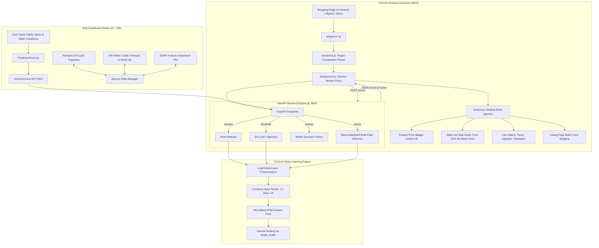

# 🌊 Microfiber Release Prediction & Textile Shelf-Life Estimation

<div align="center">

[](https://www.python.org/)
[](https://pytorch.org/)
[](https://fastapi.tiangolo.com/)
[](https://react.dev/)
[](https://vitejs.dev/)
[](https://tailwindcss.com/)
[](file:///extension/README.md)
[](https://opensource.org/licenses/MIT)

**An end-to-end, physics-grounded Deep Learning system and full-stack decision-support platform for forecasting textile microplastic shedding trajectories, garment functional shelf-life across 50 continuous laundering cycles, and live e-commerce sustainability scoring via Chrome Extension.**

[Key Features](#-key-features) • [Problem & Science](#-the-problem--environmental-science) • [Mathematical Modeling](#-mathematical--physical-framework) • [Architecture](#-system-architecture) • [Cross-Platform Setup](#-cross-platform-installation--setup-guide) • [Chrome Extension](#-chrome-browser-extension-manifest-v3) • [API Reference](#-api-specification--endpoints) • [Demo Store](#-local-demo-store--testing) • [Testing](#-automated-testing-suite)

</div>

---

## 📌 Table of Contents

1. [Project Overview](#-project-overview)
2. [Key Features](#-key-features)
3. [The Problem & Environmental Science](#-the-problem--environmental-science)
4. [Mathematical & Physical Framework](#-mathematical--physical-framework)
5. [Machine Learning Architecture (PyTorch LSTM)](#-machine-learning-architecture)
6. [Explainable AI (SHAP DeepExplainer)](#-explainable-ai-shap)
7. [System Architecture](#-system-architecture)
8. [Repository Directory Structure](#-repository-directory-structure)
9. [Cross-Platform Installation & Setup Guide](#-cross-platform-installation--setup-guide)
   - [Prerequisites](#prerequisites)
   - [Step 1: Clone the Repository](#step-1-clone-the-repository)
   - [Step 2: Backend Setup (Python Virtual Environment)](#step-2-backend-setup-python-virtual-environment)
   - [Step 3: Frontend Dashboard Setup (React & Vite)](#step-3-frontend-dashboard-setup-react--vite)
   - [Step 4: Running the Applications Locally](#step-4-running-the-applications-locally)
10. [Chrome Browser Extension (Manifest V3)](#-chrome-browser-extension-manifest-v3)
    - [How It Works](#how-the-extension-works)
    - [Step-by-Step Installation in Chrome / Edge / Brave](#step-by-step-installation-in-chrome--edge--brave)
    - [Testing on Live E-Commerce (Amazon & Myntra)](#testing-on-live-e-commerce-amazon--myntra)
11. [Local Demo Store & Testing](#-local-demo-store--testing)
12. [API Specification & Endpoints](#-api-specification--endpoints)
    - [`GET /` Health Check](#1-root-health-check)
    - [`POST /score` Full Microfiber Rating & Curve](#2-score-endpoint-comprehensive-garment-rating)
    - [`POST /extract` Composition & Spec Parser](#3-extract-endpoint-textile-property-extractor)
    - [`POST /predict` Single Cycle Prediction](#4-predict-release-at-target-wash-cycle)
    - [`POST /shelf-life` 50-Wash Sequence & Threshold](#5-estimate-complete-50-wash-trajectory--shelf-life)
13. [Automated Testing Suite](#-automated-testing-suite)
14. [Data Generation & Retraining Pipeline](#-data-generation--model-retraining-workflow)
15. [Frontend Dashboard Features](#-frontend-dashboard-features)
16. [Troubleshooting & FAQs](#-troubleshooting--faqs)
17. [Author & Acknowledgments](#-author)

---

## 🔬 Project Overview

Synthetic textiles (polyester, nylon, acrylic) shed hundreds of thousands of microscopic plastic fibers during home laundering. These **microfibers** slip through wastewater filtration facilities into marine ecosystems, bioaccumulate in marine life, and enter drinking water supplies.

Traditional textile evaluation treats microfiber release as an **isolated snapshot event** or simple regression. In reality, textile degradation is **path-dependent and sequential**: early wash cycles release superficial loose debris, while repeated laundering subjects polymer yarns to continuous mechanical shear, thermal agitation, and chemical detergent stress.

This project provides an end-to-end engineering solution:
- **Synthetic Sequence Simulator:** Generates realistic 50-wash lifecycle trajectories based on physical principles (exponential surface washout + cumulative structural wear).
- **Deep Recurrent Modeling (PyTorch LSTM):** Ingests textile properties and laundering parameters to model fiber release across 50 consecutive wash cycles using internal hidden-state accumulation.
- **Shelf-Life Estimation:** Automatically detects when fiber release crosses defined degradation thresholds ($20\,\text{mg}$ limit), providing an actionable garment durability metric.
- **Explainable AI (SHAP DeepExplainer):** Deconstructs the neural network to reveal exact feature attributions across wash sequences.
- **Production Full-Stack Application:** High-performance asynchronous **FastAPI** backend coupled with a modern **React 19 / Vite** interactive dashboard.
- **Chrome Browser Extension (Manifest V3):** Real-time shopping assistant that extracts garment specs on live e-commerce sites (Amazon, Myntra, and custom stores), injecting an isolated **Shadow DOM A–E Grade badge**, an interactive **50-wash lifecycle curve**, **wash habit simulator sliders**, and **basket microplastic impact** calculators.

---

## ✨ Key Features

- **Sequential Degradation Modeling:** Replaces static regression with a 2-layer Long Short-Term Memory (LSTM) network capable of remembering structural wear history.
- **Physics-Inspired Dual-Phase Simulation:** Incorporates both exponential decay (initial loose-fiber shedding) and progressive structural wear accumulation.
- **Garment Shelf-Life Calculator:** Predicts the exact wash cycle where garment emissions reach operational stability ($20\,\text{mg}$ limit).
- **Multi-Fiber Blend Weighting:** Computes composite shedding curves by mathematically weighting model predictions across custom blend percentages (e.g. 60% Cotton / 40% Polyester):
  $$\text{Release}_{\text{blend}}(t) = \sum_{i} w_i \cdot \text{LSTM}(f_i, t)$$
- **Explainable AI (SHAP):** Calculates Shapley additive values for deep sequence tensors to explain which variables drive emissions.
- **High-Throughput Asynchronous API:** FastAPI server with Pydantic v2 schemas and Scikit-Learn pipeline transforms for sub-millisecond inference.
- **Interactive UI with Dynamic Visualizations:** React 19 + Recharts responsive dashboard plotting predicted release curves, shelf-life indicators, and feature importance charts.
- **🛒 Chrome Browser Extension (Manifest V3):**
  - **CSS-Isolated Shadow DOM Badge:** Injected next to product prices on Amazon, Myntra, and custom stores without CSS collision.
  - **Slide-Out Side Panel:** Pure SVG 50-wash lifecycle curve with stabilization plateau markers.
  - **Interactive Wash Habit Simulator:** Sliders for Wash Temperature ($20^\circ\text{C}-60^\circ\text{C}$), Agitation ($0.5\times-1.5\times$), and Detergent dropdown dynamically re-calculate scores in real time.
  - **Greener Swaps & Mitigation:** Cold wash savings, natural fiber recommendations, and wash-bag efficiency.
  - **Search Listing Batch Mode:** Automatically badges product cards on search/category pages with cached mini grade pills.
  - **Basket Microfiber Impact:** Aggregates cumulative 50-wash microplastic emissions across shopping cart items.
- **Zero-Friction Cross-Platform Compatibility:** Runs identically on macOS (Apple Silicon M-series & Intel), Windows 10/11, and Linux distributions.

---

## 🌍 The Problem & Environmental Science

```
┌─────────────────┐       ┌─────────────────┐       ┌─────────────────┐
│ Domestic        │       │ Wastewater      │       │ Marine &        │
│ Machine Wash    │ ───►  │ Treatment Plant │ ───►  │ Freshwater      │
│ (Shear & Heat)  │       │ (60-80% filtered│       │ Ecosystems      │
└─────────────────┘       └─────────────────┘       └─────────────────┘
         │                                                   │
         ▼                                                   ▼
┌─────────────────┐                                 ┌─────────────────┐
│ Microfiber      │                                 │ Trophic Bio-    │
│ Release (mg)    │                                 │ accumulation    │
└─────────────────┘                                 │ & Microplastics │
                                                    └─────────────────┘
```

1. **Environmental Scale:** Up to $700,000$ microfibers can be released in a single 6 kg domestic wash cycle. Synthetic microfibers represent over $35\%$ of primary microplastics entering marine environments.
2. **Structural Degradation Mechanics:**
   - **Mechanical Agitation:** Drum rotation, centrifugal shear, and garment friction break surface filaments.
   - **Hydrothermal Stress:** Elevated temperatures ($30^\circ\text{C}$ to $60^\circ\text{C}$) soften synthetic polymers, lowering tensile elasticity.
   - **Chemical Degradation:** Surfactants and enzymatic builders accelerate chemical weakening of fiber coatings.
3. **The Solution:** Quantifying 50-wash shedding trajectories enables consumers to buy durable garments, optimize laundering habits, and reduce plastic emissions at the source.

---

## 📐 Mathematical & Physical Framework

The sequence dataset engine (`src/generate_sequence_data.py`) simulates 75,000 wash records across 1,500 unique fabrics modeled over 50 consecutive laundering cycles.

### 1. Base Release Formulation

Baseline fiber shedding potential ($\text{Release}_{\text{base}}$) is governed by physical parameters and laundering coefficients:

$$\text{Release}_{\text{base}} = 80 \times F_{\text{fabric}} \times F_{\text{weave}} \times F_{\text{detergent}} \times F_{\text{temp}} \times F_{\text{weight}} \times F_{\text{yarn}} \times M_{\text{agitation}}$$

Where:
- **Fabric Composition Factor ($F_{\text{fabric}}$):**
  - Nylon: $0.95$ (high tensile elasticity, continuous filament integrity)
  - Cotton: $1.00$ (natural staple fiber baseline)
  - Cotton-Poly Blend: $1.10$ (differential fiber elasticity promotes yarn pull-out)
  - Acrylic: $1.15$ (crimped staple fibers, susceptible to shear fragmentation)
  - Polyester: $1.25$ (high static build-up and surface brittleness under friction)
- **Weave Architecture Factor ($F_{\text{weave}}$):**
  - Plain: $1.00$ (tight $1/1$ interlacing limits yarn mobility)
  - Twill: $1.15$ (diagonal floats provide lower surface yarn constraint)
  - Satin: $1.25$ (long yarn floats subject surface fibers to direct abrasion)
- **Detergent Chemical Factor ($F_{\text{detergent}}$):**
  - Eco: $0.90$ (mild surfactants, neutral pH)
  - Standard: $1.00$ (alkaline builders, standard surfactants)
  - Enzyme: $1.10$ (cellulases/proteases weaken fiber anchors)
- **Thermal Agitation Factor ($F_{\text{temp}}$):**
  $$F_{\text{temp}} = 1 + 0.01 \times (T_{\text{wash}} - 30)$$
- **Areal Weight Scaling ($F_{\text{weight}}$):**
  $$F_{\text{weight}} = \frac{\text{Fabric Weight (gsm)}}{150}$$
- **Yarn Count Scaling ($F_{\text{yarn}}$):**
  $$F_{\text{yarn}} = \frac{100}{\text{Yarn Count (Ne)}}$$
  *(Lower English Cotton Count $N_e$ indicates coarser, heavier yarns with higher mass available for shedding).*
- **Mechanical Agitation ($M_{\text{agitation}}$):** Continuous machine shear coefficient $\in [0.5, 1.5]$.

### 2. Temporal Dynamics: Dual-Phase Wear Process

Physical degradation exhibits two competing physical mechanisms over lifetime $t \in [1, 50]$:

$$\text{Release}(t) = \underbrace{\text{Release}_{\text{base}} \cdot e^{-0.05 \cdot t}}_{\text{Phase 1: Exponential Washout}} + \underbrace{1.5 \cdot \text{Wear}_{\text{cumulative}}(t)}_{\text{Phase 2: Structural Wear Accumulation}} + \epsilon$$

Where:
- **Phase 1 (Surface Washout):** Residual cut ends and loose surface debris decay according to $e^{-0.05 \cdot t}$.
- **Phase 2 (Cumulative Structural Wear):** Repeated mechanical shear and hydrolytic stress damage yarn structure:
  $$\text{Wear}_{\text{cumulative}}(t) = \sum_{k=1}^{t} 0.01 \cdot \text{Release}_{\text{base}}$$
- **Stochastic Noise ($\epsilon$):** $\epsilon \sim \mathcal{N}(0, \sigma=2)$ accounts for experimental variation.
- **Physical Boundary:** $\text{Release}(t) \ge 0.1\,\text{mg}$.

### 3. Shelf-Life Metric Definition

The operational **Shelf-Life** $S$ is defined as the first wash cycle $t^*$ where microfiber release stabilizes at or below $\tau = 20\,\text{mg}$:

$$S = \min \{ t \in [1, 50] \mid \text{Release}(t) \le 20\,\text{mg} \}$$

---

## 🧠 Machine Learning Architecture

```
Sequential Input Tensor: [Batch=1, Seq=50, Features=16]
        │
        ▼
┌────────────────────────────────────────────────────────┐
│ PyTorch LSTM Layer 1 (Input=16, Hidden=64, Dropout=0.0)│
└────────────────────────────────────────────────────────┘
        │
        ▼
┌────────────────────────────────────────────────────────┐
│ PyTorch LSTM Layer 2 (Input=64, Hidden=64)             │
└────────────────────────────────────────────────────────┘
        │
        ▼
┌────────────────────────────────────────────────────────┐
│ Fully-Connected Linear Layer: nn.Linear(64, 1)         │
└────────────────────────────────────────────────────────┘
        │
        ▼
Target Inverse Scaling ──► Predicted Microfiber Release per Wash (mg)
```

### Neural Network Hyperparameters & Pipeline Details

- **Model Class:** `MicrofiberLSTM` (`backend/main.py`, `src/train_lstm.py`)
- **Input Dimensions:** 16 features:
  - 5 fabric one-hot features (`Acrylic`, `Cotton`, `Cotton-Poly Blend`, `Nylon`, `Polyester`)
  - 3 weave one-hot features (`Plain`, `Satin`, `Twill`)
  - 3 detergent one-hot features (`Eco`, `Enzyme`, `Standard`)
  - 4 continuous scaled features (`Fabric_Weight_gsm`, `Yarn_Count`, `Wash_Temperature_C`, `Mechanical_Agitation`)
  - 1 scaled wash cycle sequence number ($t \in [1, 50]$)
- **Hidden Units:** 64
- **Stacked Layers:** 2 layers
- **Batch Processing:** `batch_first=True`
- **Output Layer:** `nn.Linear(64, 1)` projecting sequence hidden states to continuous release
- **Loss Function:** Mean Squared Error (`nn.MSELoss()`)
- **Optimizer:** Adam (`lr=0.005`)
- **Pretrained Artifacts in `models/`:**
  - `models/lstm_model.pth`: Serialized PyTorch weights
  - `models/preprocessor.pkl`: Scikit-learn `ColumnTransformer`
  - `models/wash_scaler.pkl`: Temporal wash sequence `StandardScaler`
  - `models/target_scaler.pkl`: Target emission `StandardScaler`

---

## 🔍 Explainable AI (SHAP)

Deep neural network decisions are interpreted via **SHAP (SHapley Additive exPlanations)** in `src/explain_shap.py`.

```
                    ┌─────────────────────────┐
                    │ DeepExplainer Sequence  │
                    │      Attributions       │
                    └─────────────────────────┘
                                 │
     ┌───────────────────────────┼───────────────────────────┐
     ▼                           ▼                           ▼
Yarn Count (Ne)           Weave Structure             Wash Temperature
Inverse thickness         Satin float exposure        Polymer softening
drives fiber volume       increases friction          accelerates shear
```

- **Sequence Attribution:** Evaluates gradients of the terminal sequence step ($t=50$) with respect to input sequences:
  $$\phi_i = \sum_{S \subseteq F \setminus \{i\}} \frac{|S|!(|F| - |S| - 1)!}{|F|!} \left[ f_x(S \cup \{i\}) - f_x(S) \right]$$
- **Primary Influences:** Coarse yarns (low $N_e$) have the highest marginal attribution. Satin and twill weave expose more loose surface fiber than plain weaves. Higher temperatures soften synthetic fibers, accelerating degradation.
- **Visual Artifact:** Generated automatically at `frontend/public/shap_summary.png`.

---

## 🏗️ System Architecture



---

## 📁 Repository Directory Structure

```text
microfiber-shelf-life/
│
├── backend/                             # High-performance FastAPI server
│   └── main.py                          # Endpoints: /score, /extract, /predict, /shelf-life
│
├── extension/                           # Manifest V3 Chrome Browser Extension
│   ├── manifest.json                    # Extension permissions, host permissions & configuration
│   ├── background.js                    # MV3 Service Worker (API proxying & chrome.storage)
│   ├── content.js                       # Shadow DOM badge, SVG chart, live sliders & panel
│   ├── extractors.js                    # Regex parsers for composition, blends, GSM, weave, yarn count
│   ├── generate_icons.js                # Icon generator utility
│   ├── icons/                           # 16x16, 48x48, 128x128 extension icons
│   ├── popup/                           # Toolbar popup (popup.html, popup.js, popup.css)
│   ├── adapters/                        # E-commerce DOM adapters
│   │   ├── base.js                      # Self-registering adapter registry
│   │   ├── amazon.js                    # Amazon.in / Amazon.com desktop, mobile & responsive adapter
│   │   ├── myntra.js                    # Myntra.com product & listing adapter
│   │   └── demo-shop.js                 # Local demo store adapter (data-mf-* attributes)
│   ├── tests/                           # Extension automated test suite
│   │   ├── test_extractors.js           # Node.js regex unit tests (7 passed)
│   │   └── test_backend_api.py          # Python integration tests for FastAPI endpoints (5 passed)
│   └── README.md                        # Extension-specific developer documentation
│
├── demo-shop/                           # Interactive local test store
│   └── index.html                       # 6 diverse garments, PDP views, search cards, and checkout
│
├── frontend/                            # React 19 single-page dashboard
│   ├── public/                          # Static public assets (shap_summary.png, icons)
│   ├── src/                             # React application source code
│   │   ├── components/                  # Header, PredictionForm, ResultCard, MicrofiberChart
│   │   ├── App.jsx                      # App root & API orchestration
│   │   ├── App.css                      # Styling tokens & layout
│   │   └── main.jsx                     # Vite mount point
│   ├── package.json                     # Frontend dependencies
│   └── vite.config.js                   # Vite configuration
│
├── src/                                 # Data generators & ML scripts
│   ├── generate_sequence_data.py        # 50-wash sequence dataset generator (75,000 samples)
│   ├── train_lstm.py                    # PyTorch LSTM network training script
│   ├── explain_shap.py                  # SHAP DeepExplainer interpretability script
│   ├── generate_data.py                 # Baseline tabular snapshot data generator
│   └── train.py                         # Classical ML baseline benchmarks
│
├── models/                              # Pretrained weights and scalers
│   ├── lstm_model.pth                   # PyTorch weights for MicrofiberLSTM (2-layer, h=64)
│   ├── preprocessor.pkl                 # ColumnTransformer (StandardScaler + OneHotEncoder)
│   ├── wash_scaler.pkl                  # Temporal wash index scaler
│   └── target_scaler.pkl                # Target emission scaler
│
├── data/                                # Generated datasets
│   ├── microfiber_sequence_dataset.csv  # 75,000 sequence rows (1,500 fabrics x 50 washes)
│   └── microfiber_dataset.csv           # 3,000 tabular snapshot records
│
├── requirements.txt                     # Pinned Python package dependencies
├── requirements_clean.txt               # Unpinned clean dependencies
└── README.md                            # Comprehensive project guide (this file)
```

---

## 💻 Cross-Platform Installation & Setup Guide

This guide enables anyone to clone and run the full stack on any machine: **Windows 10/11**, **macOS (Apple Silicon M1–M4 & Intel)**, or **Linux (Ubuntu/Debian, Fedora, Arch)**.

### Prerequisites

| Tool | Minimum Version | Installation Link / Command |
| :--- | :---: | :--- |
| **Python** | `3.10` or higher | [python.org](https://www.python.org/downloads/) • macOS: `brew install python` • Linux: `sudo apt install python3 python3-venv python3-pip` |
| **Node.js & npm** | `Node v18+`, `npm v9+` | [nodejs.org](https://nodejs.org/) • macOS: `brew install node` |
| **Git** | `2.x+` | [git-scm.com](https://git-scm.com/) |
| **Google Chrome** | Latest | Any Chromium browser (Chrome, Edge, Brave) |

---

### Step 1: Clone the Repository

Open your terminal or command prompt:

```bash
git clone https://github.com/Sahil-2005/microfiber-shelf-life.git
cd microfiber-shelf-life
```

---

### Step 2: Backend Setup (Python Virtual Environment)

#### 🍏 On macOS / Linux

```bash
# 1. Create virtual environment named 'venv'
python3 -m venv venv

# 2. Activate virtual environment
source venv/bin/activate

# 3. Upgrade pip
pip install --upgrade pip

# 4. Install dependencies
pip install -r requirements.txt
```

> **macOS Apple Silicon:** PyTorch automatically uses optimized CPU/Metal backend without extra configuration.

#### 🪟 On Windows

Open **PowerShell** or **Command Prompt** in the project root:

```powershell
# 1. Create virtual environment named 'venv'
python -m venv venv

# 2. Activate virtual environment
# In PowerShell:
.\venv\Scripts\Activate.ps1

# (If PowerShell displays a script policy warning, run once:
#  Set-ExecutionPolicy -ExecutionPolicy RemoteSigned -Scope CurrentUser)

# OR in Command Prompt (cmd.exe):
.\venv\Scripts\activate.bat

# 3. Upgrade pip
python -m pip install --upgrade pip

# 4. Install dependencies
pip install -r requirements.txt
```

---

### Step 3: Frontend Dashboard Setup (React & Vite)

Open a **second terminal window** and run:

```bash
cd frontend

# Install dependencies
npm install
```

---

### Step 4: Running the Applications Locally

You will run the backend, frontend, and optional demo server in separate terminal windows:

#### Terminal 1: Launch FastAPI Backend Server

Ensure `(venv)` is activated:

```bash
# From project root (microfiber-shelf-life/):
python -m uvicorn backend.main:app --host 127.0.0.1 --port 8000 --reload
```

- **API Base:** `http://127.0.0.1:8000`
- **Interactive Swagger Docs:** `http://127.0.0.1:8000/docs`
- **ReDoc Documentation:** `http://127.0.0.1:8000/redoc`

#### Terminal 2: Launch React Web Dashboard

```bash
# From frontend directory (microfiber-shelf-life/frontend/):
npm run dev
```

- **Dashboard URL:** `http://localhost:5173`

#### Terminal 3: (Optional) Launch Local Demo Store

```bash
# From project root (microfiber-shelf-life/):
python -m http.server 3000
```

- **Demo Store URL:** `http://localhost:3000/demo-shop/index.html`

---

## 🛒 Chrome Browser Extension (Manifest V3)

The extension evaluates live garments as you browse e-commerce sites, parsing material compositions, running LSTM inference, and injecting sustainability badges.

### How the Extension Works

1. **DOM Adapter Detection:** Detects whether you are on Amazon, Myntra, or the local demo store.
2. **Textile Feature Extraction:** Uses regex parsers in `extension/extractors.js` to extract fiber type, blend percentages, GSM, weave type, and yarn count from product titles, bullet points, technical spec tables, and descriptions.
3. **Backend Communication:** The MV3 service worker calls `POST /score` on your local FastAPI server (`http://127.0.0.1:8000`).
4. **Shadow DOM Injection:** Builds a custom badge next to the price element using closed Shadow DOM, ensuring complete CSS isolation from site stylesheets.
5. **Interactive Side Panel:** Clicking the badge opens a slide-out panel with an interactive pure SVG lifecycle curve and live wash habit simulation sliders.

---

### Step-by-Step Installation in Chrome / Edge / Brave

1. Open **Google Chrome** (or Edge/Brave).
2. Go to the extensions management page by entering:
   ```text
   chrome://extensions
   ```
3. Enable the **Developer mode** toggle in the top-right corner.
4. Click the **Load unpacked** button in the top-left corner.
5. In the file picker, select the `extension/` folder inside `microfiber-shelf-life/`.
6. The **Microfiber Score** extension is now installed. Pin it to your toolbar.
7. Click the extension toolbar icon. You will see:
   - Green status pill: **`● API connected`**
   - Wash habit configuration defaults (Temperature, Agitation, Detergent, Frequency).

---

### Testing on Live E-Commerce (Amazon & Myntra)

1. Make sure your FastAPI backend is running on `http://127.0.0.1:8000`.
2. Open any apparel product page:
   - **Amazon India / US:** Navigate to any clothing item (e.g. polo shirt, trousers, hoodie, fleece).
   - **Myntra:** Navigate to any t-shirt or garment page.
3. **On Product Pages:** Look directly below the price. You will see the **Microfiber Score Badge**:
   - Letter Grade (**A–E**) with color ring.
   - Cumulative 50-wash emission (e.g. `~12.65g over 50 washes`).
   - Confidence indicator (**HIGH**, **MEDIUM**, or **LOW** depending on specs found).
4. **Click the Badge:**
   - The slide-out side panel appears with the **50-Wash Lifecycle Curve** and stabilization marker.
   - Adjust the **Wash Temperature** slider (e.g., lower to $20^\circ\text{C}$) or **Mechanical Agitation** slider.
   - The score, badge, and curve recalculate via the LSTM model in real time.
5. **On Search Pages:** Search for `cotton t-shirt` or `fleece jacket`. Mini badges (`[Grade] [X.Xg]`) will appear on each product card.

---

## 🏪 Local Demo Store & Testing

For testing without live internet or shopping accounts, a complete test store is included in `demo-shop/index.html`:

```bash
# Serve from project root:
python -m http.server 3000
```

Open: **`http://localhost:3000/demo-shop/index.html`**

### Test Products Included:

| Product | Composition | Expected Result |
| :--- | :--- | :--- |
| **Pure Earth Organic Tee** | 100% Organic Cotton (140 GSM, Plain) | **Grade A** (Low shed, 100% biodegradable) |
| **AeroTech Shell Jacket** | 100% Ripstop Nylon (160 GSM, Plain) | **Grade B** (Good, continuous filament) |
| **Urban Comfort Hoodie** | 60% Cotton / 40% Poly (240 GSM) | **Grade C/D** (Blended microplastics) |
| **ArcticSummit Fleece** | 100% Recycled Polyester (320 GSM) | **Grade E** (Heavy shedding microplastics) |
| **Nordic Cable Sweater** | 100% Acrylic Soft-Spun (280 GSM) | **Grade D/E** (Staple fiber breakage) |
| **Artisan Twill Shirt** | 100% Organic Linen (160 GSM, Twill) | **Grade A** (Natural cellulosic flax) |

- **Product Detail View:** Click any item to see badge injection, adjust sliders, and explore greener swaps.
- **Cart-Level Summary:** Click the **Cart** button in the header. The extension detects the items and injects a **Basket Microfiber Impact** banner summarizing total 50-wash microplastic emissions.

---

## 📡 API Specification & Endpoints

The FastAPI backend exposes the following REST endpoints:

### 1. Root Health Check
- **Method:** `GET`
- **Endpoint:** `/`
- **Response:**
  ```json
  {
    "message": "Advanced Microfiber LSTM Prediction API is running"
  }
  ```

---

### 2. `/score` Endpoint (Comprehensive Garment Rating)
- **Method:** `POST`
- **Endpoint:** `/score`
- **Description:** Accepts garment specifications or raw text, computes blend-weighted multi-fiber LSTM predictions across 50 wash cycles, assigns an A–E sustainability grade, quantifies synthetic microplastics, and returns explainability reasons and greener swaps.

#### Request Schema (`application/json`):
```json
{
  "Fabric_Type": "Cotton-Poly Blend",
  "Blend": { "Cotton": 0.6, "Polyester": 0.4 },
  "Fabric_Weight_gsm": 180.0,
  "Yarn_Count": 30.0,
  "Weave_Type": "Plain",
  "Wash_Temperature_C": 40.0,
  "Detergent_Type": "Standard",
  "Mechanical_Agitation": 1.0,
  "Number_of_Washes": 50,
  "Product_Title": "Urban Comfort Poly-Cotton Athletic Hoodie",
  "Raw_Text": "60% Cotton 40% Polyester blend 180 GSM"
}
```
*(All fields are optional with intelligent fallback to physical baseline defaults).*

#### Response Schema (`200 OK`):
```json
{
  "grade": "C",
  "grade_label": "Fair",
  "color": "#ca8a04",
  "ring_color": "#fef08a",
  "confidence": "high",
  "uncertainty_range": {
    "low_g": 12.76,
    "high_g": 15.28,
    "margin_pct": 9
  },
  "cumulative_grams": 14.02,
  "cumulative_release_mg": 14020.15,
  "per_wash_avg_mg": 280.4,
  "synthetic_percentage": 40,
  "synthetic_microplastics_g": 5.61,
  "wash_values": [1, 2, 3, "...", 50],
  "predictions": [323.5, 318.2, "...", 245.1],
  "cumulative_predictions": [323.5, 641.7, "...", 14020.15],
  "estimated_shelf_life": 32,
  "reasons": [
    {
      "icon": "⚠️",
      "type": "material",
      "title": "Synthetic fibers (40%)",
      "text": "Cotton-Poly Blend releases non-biodegradable microplastics."
    },
    {
      "icon": "🌡️",
      "type": "wash_temp",
      "title": "Warm wash (40°C)",
      "text": "Warm water weakens fiber bonds, increasing shedding by up to 25%."
    }
  ],
  "greener_swaps": [
    {
      "title": "Wash at 20°C (Cold Cycle)",
      "potential_reduction": "Saves ~2.52g shedding over 50 washes",
      "description": "Dropping temperature preserves garment life and reduces shedding."
    },
    {
      "title": "Use a Guppyfriend Washing Bag",
      "potential_reduction": "Filters up to 86% of microfibers",
      "description": "Traps broken microfibers while protecting clothes from drum friction."
    }
  ],
  "defaults_used": []
}
```

#### cURL Example:
```bash
curl -X POST "http://127.0.0.1:8000/score" \
     -H "Content-Type: application/json" \
     -d '{"Blend": {"Cotton": 0.6, "Polyester": 0.4}, "Fabric_Weight_gsm": 180, "Wash_Temperature_C": 40}'
```

---

### 3. `/extract` Endpoint (Textile Property Extractor)
- **Method:** `POST`
- **Endpoint:** `/extract`
- **Description:** Server-side fallback parser that extracts structured fiber composition, GSM, weave, and yarn count from unstructured text.

#### Request Schema:
```json
{
  "text": "Men 60% Cotton 40% Polyester Athletic T-Shirt 180 GSM Plain Weave"
}
```

#### Response Schema:
```json
{
  "fabric_type": "Cotton-Poly Blend",
  "blend": {
    "Cotton": 0.6,
    "Polyester": 0.4
  },
  "gsm": 180.0,
  "weave": "Plain",
  "yarn_count": null,
  "confidence": "high"
}
```

---

### 4. `/predict` (Release at Target Wash Cycle)
- **Method:** `POST`
- **Endpoint:** `/predict`
- **Description:** Single wash cycle prediction using standard `FabricInput`.

#### Request Schema:
```json
{
  "Fabric_Type": "Polyester",
  "Fabric_Weight_gsm": 160.0,
  "Yarn_Count": 65.0,
  "Weave_Type": "Twill",
  "Wash_Temperature_C": 40.0,
  "Detergent_Type": "Standard",
  "Mechanical_Agitation": 1.0,
  "Number_of_Washes": 15
}
```

#### Response:
```json
{
  "predicted_microfiber_release_mg": 128.45
}
```

---

### 5. `/shelf-life` (50-Wash Sequence & Threshold)
- **Method:** `POST`
- **Endpoint:** `/shelf-life`
- **Description:** Evaluates garment across all 50 sequential washes against the $20\,\text{mg}$ limit.

#### Request Schema:
```json
{
  "Fabric_Type": "Cotton",
  "Fabric_Weight_gsm": 140.0,
  "Yarn_Count": 80.0,
  "Weave_Type": "Plain",
  "Wash_Temperature_C": 30.0,
  "Detergent_Type": "Eco",
  "Mechanical_Agitation": 0.8,
  "Number_of_Washes": 1
}
```

#### Response:
```json
{
  "wash_values": [1, 2, "...", 50],
  "predictions": [78.23, 74.12, "...", 19.45],
  "threshold": 20,
  "estimated_shelf_life": 48
}
```

---

## 🧪 Automated Testing Suite

The repository includes test suites for both extension regex parsers and backend API routes:

### 1. Extractor Unit Tests (Node.js)
Validates fabric identification, blend percentage parsing, GSM, weave structures, and yarn count:

```bash
node extension/tests/test_extractors.js
```
*Output: 7 passed, 0 failed.*

### 2. Backend API Integration Tests (Python)
Validates `/extract`, `/score` (blend & defaults fallback), `/predict`, and `/shelf-life`:

```bash
# On Windows:
venv\Scripts\python.exe extension/tests/test_backend_api.py

# On macOS / Linux:
python extension/tests/test_backend_api.py
```
*Output: 5 passed, 0 failed.*

---

## 🔄 Data Generation & Model Retraining Workflow

All data synthesis, model training, and explainability scripts can be run from the command line:

```bash
# 1. Regenerate synthetic 75,000-wash sequence dataset
python src/generate_sequence_data.py
# Output: data/microfiber_sequence_dataset.csv

# 2. Retrain the PyTorch LSTM model and serialize scalers
python src/train_lstm.py
# Output:
#   - models/lstm_model.pth (Model weights)
#   - models/preprocessor.pkl (Column transformer)
#   - models/wash_scaler.pkl (Temporal scaler)
#   - models/target_scaler.pkl (Target scaler)

# 3. Regenerate the SHAP attribution plot
python src/explain_shap.py
# Output: frontend/public/shap_summary.png

# 4. (Optional) Run classical ML benchmark comparison
python src/generate_data.py  # Generates 3,000 snapshot records
python src/train.py          # Trains Random Forest, Gradient Boosting, Extra Trees
```

---

## 🖥️ Frontend Dashboard Features

The web client (`frontend/`) is built with **React 19**, **Vite 8**, **Tailwind CSS v4**, and **Recharts 3**:

```
┌────────────────────────────────────────────────────────────────────────┐
│ [MF] Textile care intelligence | Microfiber release lab   [● API ready]│
├────────────────────────────────────────────────────────────────────────┤
│ See how every wash changes the story.                                  │
│                                                                        │
│ 01 / FABRIC PROFILE                                                    │
│ [Fabric Type: Polyester ▼]   [Weave Type: Twill    ▼]                  │
│ [Fabric Weight (gsm): 160]   [Yarn Count (Ne):   65 ]                  │
│ [Temperature (°C):    40 ]   [Detergent: Standard  ▼]                  │
│ [Mechanical Agitation: 1 ]   [Current Washes:    10 ]                  │
│ [ Run prediction ↗ ]                                                   │
├────────────────────────────────────────────────────────────────────────┤
│ ┌───────────────────────────┐    ┌───────────────────────────────────┐ │
│ │ SELECTED WASH PROFILE     │    │ MODEL THRESHOLD                   │ │
│ │ Predicted release: 128 mg │    │ Estimated shelf life: 46 washes   │ │
│ └───────────────────────────┘    └───────────────────────────────────┘ │
├────────────────────────────────────────────────────────────────────────┤
│ 02 / LIFECYCLE CURVE (Release across 50 wash cycles)                   │
│                                                                        │
│  150 mg ──╮                                                            │
│  100 mg ───╲                                                           │
│   50 mg ─────╲───────────────────────────────────────                  │
│   20 mg - - - -╲- - - - - - - - - - - - - - - - - - - [ 20 mg limit ] │
│    0 mg ────────┴──────┴──────┴──────┴──────┴──────┴                   │
│         Wash 1      10     20     30     40     50                     │
├────────────────────────────────────────────────────────────────────────┤
│ 03 / AI EXPLAINABILITY (SHAP Feature Importance Summary)               │
│ [ Horizontal bar plot indicating relative factor impacts ]             │
└────────────────────────────────────────────────────────────────────────┘
```

1. **Reactive Parameters:** Sliders and dropdowns configure fabric parameters, yarn geometry, agitation, and wash temperatures.
2. **Real-time Dual KPI Cards:**
   - **Predicted Release (mg):** Microfiber shed amount for the requested wash cycle.
   - **Estimated Shelf-Life (washes):** Number of laundering cycles before reaching the $20\,\text{mg}$ limit.
3. **Interactive Recharts Visualization:** Fluid SVG graph plotting continuous 50-wash decay against the reference limit.
4. **Embedded SHAP Explainability:** Informs the user which physical attributes contributed most heavily to degradation.

---

## 🛠️ Troubleshooting & FAQs

### 1. Extension displays `API 422: Unprocessable Entity`
**Solution:** Ensure you are using the updated `backend/main.py`. Fields in `ScoreRequest` must use `Optional[...] = None` to accept null values for unlisted specs. Then click **Clear all** and **🔄 Reload** on `chrome://extensions`.

### 2. Badge does not appear on an Amazon page
**Solution:**
- Amazon product URLs come in several formats: `/dp/ASIN`, `/gp/product/ASIN`, and `/gp/aw/d/ASIN` (mobile/responsive layout). The updated `amazon.js` supports all three.
- After saving adapter changes, always reload the extension at `chrome://extensions` and refresh the shopping page with **`F5`** / **`Ctrl + R`**.

### 3. Windows PowerShell: `Execution of scripts is disabled on this system`
**Solution:** PowerShell restricts script execution by default. Run this once in PowerShell:
```powershell
Set-ExecutionPolicy -ExecutionPolicy RemoteSigned -Scope CurrentUser
```
Then rerun `.\venv\Scripts\Activate.ps1`.

### 4. `ModuleNotFoundError: No module named 'torch'` or `'fastapi'`
**Solution:** Ensure your virtual environment is active before starting the server. Look for `(venv)` in your terminal prompt. If missing, activate it:
- macOS/Linux: `source venv/bin/activate && pip install -r requirements.txt`
- Windows: `.\venv\Scripts\Activate.ps1 && pip install -r requirements.txt`

### 5. Port `8000` or `5173` is already in use
**Solution:**
- To run FastAPI on a different port:
  ```bash
  python -m uvicorn backend.main:app --host 127.0.0.1 --port 8080 --reload
  ```
- Update extension `apiUrl` in `extension/background.js` or via the extension popup settings.
- To run Vite on a different port:
  ```bash
  npm run dev -- --port 3001
  ```

---

## 👤 Author

**Sahil Gawade**  
B.Tech in Artificial Intelligence & Machine Learning

<div align="left">
  <a href="https://github.com/Sahil-2005" target="_blank"></a>
  <a href="https://www.linkedin.com/in/sahil-gawade-920a0a242/" target="_blank"></a>
  <a href="mailto:gawadesahil.dev@gmail.com" target="_blank"></a>
  <a href="https://leetcode.com/u/sahilgawade4321/" target="_blank"></a>
  <a href="https://sahil-gawade.vercel.app/" target="_blank"></a>
</div>

---

## 📄 License

This project is licensed under the **MIT License**. See the `LICENSE` file for details.
